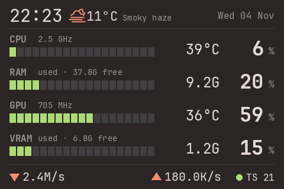
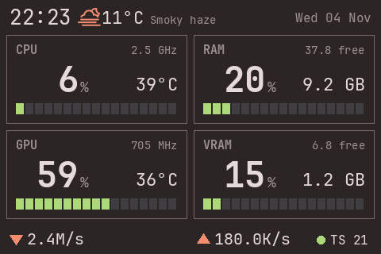

# omarchy-info-panel

A small daemon that shows live PC stats on a 3.5" USB LCD (the cheap "USB2LCD AIDA64" AX206-style panels), on Arch Linux. It follows your [Omarchy](https://omarchy.org/) theme colours and switches when you switch theme.

| `layout = "rows"` | `layout = "tiles"` |
|---|---|
|  |  |

*Screenshots are 1:1 renders of the 480×320 frame (Ristretto theme), with sample network traffic.*

## What it shows

- Clock and date, plus optional weather (icon, temperature, condition)
- **CPU:** load, average frequency, temperature
- **RAM:** load, used / free
- **GPU:** load, clock, temperature
- **VRAM:** load, used / free
- Network download / upload on one line
- Optional Tailscale status (running + peers online)
- Two layouts, English or Italian, brightness and refresh rate from a config file

## Hardware

Tested with the 3.5" IPS panel from [this AliExpress listing](https://www.aliexpress.com/item/1005002391117312.html): USB ID `1908:0102`, manufacturer "QTKeJi.Ltd", product "USB-Display", 480×320. Other AX206-based panels with the same USB ID will probably work. Check with `lsusb | grep 1908:0102`.

## Requirements

- Arch Linux (the installer uses `pacman` and a systemd user service)
- An NVIDIA GPU with `nvidia-smi` for the GPU and VRAM rows (without it they show `n/a`)
- An AMD CPU for the CPU temperature (read from the `k10temp` sensor; on other CPUs it shows `--`)
- Omarchy for theme following (without it the built-in `neutral` colours are used)
- `tailscale` only if you want the Tailscale indicator

## Install

```bash
git clone https://github.com/raccoon-overlord-dev/omarchy-info-panel.git
cd omarchy-info-panel
./install.sh
```

The installer, which asks for your sudo password where needed:

1. installs `python-pyusb` and `python-pillow` (and the JetBrains Mono Nerd Font if it is missing)
2. adds a udev rule so your user can talk to the LCD without sudo
3. creates `~/.config/lcdd/config.toml` with defaults (an existing file is never overwritten)
4. installs and starts the `lcdd` systemd user service

It is safe to re-run. Unplug and replug the display once after the first install if it is not detected.

## Configuration

Edit `~/.config/lcdd/config.toml`, then apply with `systemctl --user reload lcdd`. Keys you leave out use the defaults.

```toml
layout         = "rows"     # "rows" | "tiles"
theme          = "omarchy"  # "omarchy" (follow the Omarchy theme) | "neutral" (built-in colours)
refresh        = 1.0        # seconds between updates, minimum 0.2
brightness     = 7          # backlight 0-7 (0 = off, 7 = full)
language       = "en"       # "en" | "it"
show_weather   = true       # icon, temperature and condition after the clock
show_tailscale = true       # dot + "TS <peers online>" on the network line
weather_city   = ""         # e.g. "Vicenza"; empty = use the Omarchy weather location
```

| Key | Values | Notes |
|---|---|---|
| `layout` | `rows`, `tiles` | One line per metric, or a 2×2 grid. |
| `theme` | `omarchy`, `neutral` | `omarchy` reads `~/.local/state/omarchy/current/theme/colors.toml` and redraws within about a second when the Omarchy theme changes. |
| `refresh` | seconds, min `0.2` | A full-screen redraw takes about 0.8 s, so going far below 1 s will not help. |
| `brightness` | `0`-`7` | `0` turns the backlight off. |
| `language` | `en`, `it` | Weekday and month names, "used / free", and the weather condition text. |
| `show_weather` | `true`, `false` | Weather comes from wttr.in, refreshed every 10 minutes, metric units only. |
| `show_tailscale` | `true`, `false` | Checked every 10 seconds. |
| `weather_city` | city name | Overrides the Omarchy weather location (`~/.local/state/omarchy/settings/weather.json`). If both are unset, wttr.in detects the location from your IP. |

An unknown `layout`, `theme` or `language` falls back to the default and logs a warning. `brightness` and `refresh` are clamped to their ranges.

## Everyday commands

```bash
systemctl --user status lcdd        # is it running?
systemctl --user reload lcdd        # apply config changes
systemctl --user restart lcdd       # restart (also resets the display)
journalctl --user -u lcdd -f        # live logs
python lcdd.py --png out.png        # render one frame to a PNG, no hardware needed
```

## Uninstall

```bash
systemctl --user disable --now lcdd
rm ~/.config/systemd/user/lcdd.service
sudo rm /etc/udev/rules.d/99-ax206.rules
rm -r ~/.config/lcdd
```

## Troubleshooting

- **Screen is frozen on the last frame:** the daemon is not running. Check `systemctl --user status lcdd`.
- **Screen is black:** the backlight is off (`brightness = 0`) or the display is stuck. Set a brightness, reload, and if that does not help unplug and replug the display. The daemon resets the device each time it starts.
- **`lcd error ... retrying` in the logs:** the USB link dropped or timed out. The daemon retries every 3 seconds on its own.
- **Weather is missing:** check that `curl https://wttr.in/?format=3` works. The weather only appears after the first successful fetch.
- **Odd characters or missing weather icons:** the JetBrains Mono Nerd Font is missing. Check `/usr/share/fonts/TTF/JetBrainsMonoNerdFont-Regular.ttf`.

## How it works

`lcdd.py` reads stats from `/proc`, `/sys` and `nvidia-smi`, draws a 480×320 frame with Pillow, and sends only the changed rectangles to the display over USB (bulk transfers, RGB565). Weather and Tailscale are fetched in a background thread, so a slow network call never freezes the display.
The protocol is the AX206 "dpf-ax" one, as documented by [lcd4linux-ax206](https://github.com/ukoda/lcd4linux-ax206).

## Limitations

- GPU stats are NVIDIA only; CPU temperature is AMD only.
- Weather is metric only.
- Network speed is the sum of all interfaces except loopback.
- A full redraw is slow (about 0.8 s), so there is no animation.
